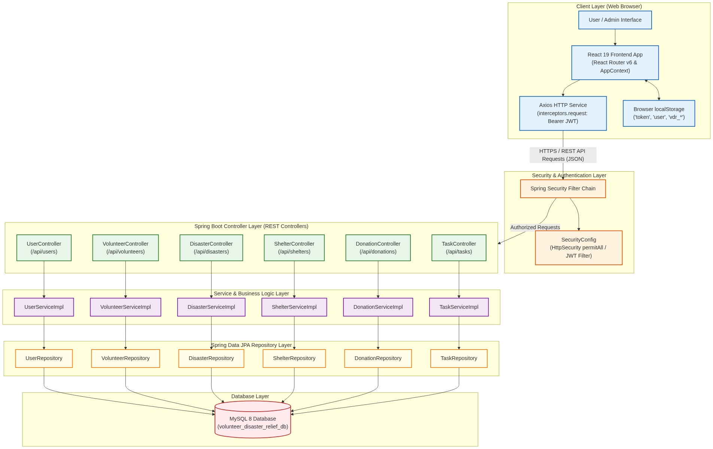
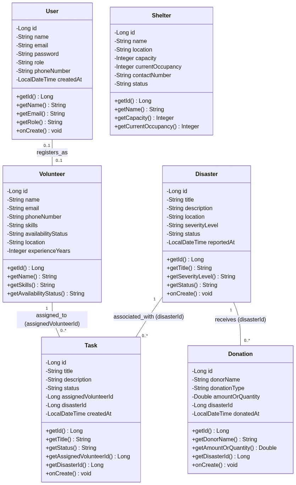
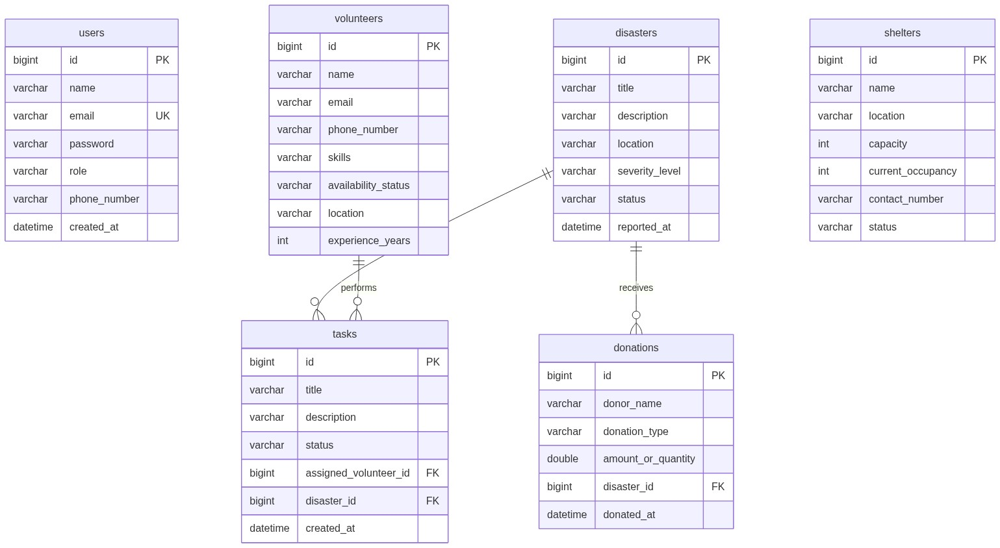

<div align="center">

# 🌍 Volunteer Disaster Relief System

### 🚑 Empowering Communities Through Smart Disaster Management

<p align="center">
  
  
  
  
  
  
  
</p>

---

## 🌟 Project Overview

The **Volunteer Disaster Relief System** is a modern full-stack web application developed to simplify disaster management by connecting **administrators**, **volunteers**, **donors**, **shelter coordinators**, and **affected people** through one centralized platform.

This project enables organizations to coordinate rescue operations efficiently, manage volunteers, allocate shelters, monitor donations, and provide real-time disaster information.

---

## 🎯 Problem Statement

Natural disasters often create communication gaps between volunteers, relief organizations, and affected communities. Traditional manual processes delay rescue operations and resource allocation.

The Volunteer Disaster Relief System provides a digital platform to streamline disaster response by managing volunteers, shelters, donations, relief tasks, and disaster records in one secure application.

---

# 🎯 Objectives

- Improve disaster response efficiency
- Digitize volunteer management
- Manage shelters effectively
- Allocate relief tasks quickly
- Track donations transparently
- Provide centralized disaster information
- Reduce paperwork
- Improve coordination among all stakeholders

---

# ✨ Core Features

## 👤 User Module

- User Registration
- Secure Login
- JWT Authentication
- Profile Management
- Change Password
- Role-Based Access

---

## 🙋 Volunteer Module

- Volunteer Registration
- Skill Management
- Availability Status
- Assign Relief Tasks
- View Assigned Tasks
- Volunteer Reports

---

## 🌪 Disaster Module

- Add Disaster Information
- Update Disaster Status
- Disaster Location
- Disaster Severity
- Disaster Reports
- Emergency Notifications

---

## 🏠 Shelter Module

- Register Shelter
- Capacity Management
- Shelter Availability
- Occupancy Tracking
- Shelter Allocation

---

## 💰 Donation Module

- Monetary Donations
- Material Donations
- Donation Tracking
- Donation History
- Donation Reports

---

## 📋 Relief Task Module

- Create Tasks
- Assign Volunteers
- Track Task Status
- Update Task Progress
- Completion Reports

---

## 👨‍💼 Admin Dashboard

- Dashboard Analytics
- User Management
- Volunteer Management
- Disaster Management
- Donation Monitoring
- Shelter Monitoring
- Reports & Analytics

---

# 🛠 Technology Stack

| Category | Technologies |
|----------|--------------|
| Frontend | React.js, HTML5, CSS3, JavaScript, Bootstrap |
| Backend | Java 21, Spring Boot, Spring Security, Spring Data JPA |
| Database | MySQL |
| Build Tool | Maven |
| IDE | Visual Studio Code |
| API Testing | Postman |
| Version Control | Git & GitHub |

---

# 📂 Project Modules

✅ User Management

✅ Volunteer Management

✅ Disaster Management

✅ Shelter Management

✅ Donation Management

✅ Task Management

✅ Admin Dashboard

---

# ⭐ Highlights

- Modern REST API Architecture
- Responsive UI
- Secure Authentication
- MySQL Database Integration
- Clean Layered Architecture
- Scalable Design
- Easy Deployment
- Academic Project Ready

# 📐 System Documentation

This repository includes comprehensive, academic-grade project diagrams generated directly from the source code implementation (Spring Boot backend entities, controllers, services, repositories, JPA database schema, and React frontend context/routes).

### 📑 Quick Links to Diagram Documents
- 🏗️ **[System Architecture](docs/diagrams/system_architecture.png)** ([Mermaid Source](docs/diagrams/system_architecture.mmd))
- 📘 **[UML Class Diagram](docs/diagrams/uml_class_diagram.png)** ([Mermaid Source](docs/diagrams/uml_class_diagram.mmd))
- 🗄️ **[ER Diagram](docs/diagrams/er_diagram.png)** ([Mermaid Source](docs/diagrams/er_diagram.mmd))
---

## 1. 🏗️ System Architecture Diagram

High-level multi-tiered layered architecture diagram illustrating the React 19 Client Layer, Spring Security & JWT Authentication Filter, Spring Boot Controllers, Service Layer, Spring Data JPA Repositories, and MySQL Database.

<p align="center">
  
</p>

---

## 2. 📘 UML Class Diagram

Detailed UML Class Diagram derived directly from Java entity classes (`User`, `Volunteer`, `Disaster`, `Shelter`, `Donation`, `Task`), showing exact attributes, data types, primary keys, foreign keys, methods, and relationships.

<p align="center">
  
</p>

---

## 3. 🗄️ ER Diagram (Entity-Relationship)

Database schema diagram using Crow's Foot notation based on JPA entities (`users`, `volunteers`, `disasters`, `shelters`, `donations`, `tasks`) and foreign key relationships.

<p align="center">
  
</p>

---

# 🔄 Project Workflow

```text
User Registration
        │
        ▼
User Login
        │
        ▼
Dashboard
        │
        ▼
Manage Disaster Information
        │
        ▼
Register Volunteers
        │
        ▼
Assign Relief Tasks
        │
        ▼
Manage Shelters
        │
        ▼
Track Donations
        │
        ▼
Generate Reports
        │
        ▼
Logout
```

# 📚 Project Documentation

This project includes the following documentation:

- ✅ Software Requirements Specification (SRS)
- ✅ Software Design Document (SDD)
- ✅ UML Class Diagram
- ✅ ER Diagram
- ✅ Use Case Diagram
- ✅ Sequence Diagram
- ✅ Activity Diagram
- ✅ System Architecture
- ✅ Database Schema
- ✅ REST API Documentation
- ✅ User Manual
- ✅ Installation Guide

---


# 🚀 Future Enhancements

- 🤖 AI-based Disaster Prediction
- 📍 Live Volunteer GPS Tracking
- 📱 Android Mobile Application
- ☁ Cloud Deployment (AWS)
- 📧 Email Notifications
- 📲 SMS Alerts
- 🗺 Interactive GIS Maps
- 📊 Advanced Analytics Dashboard
- 🌐 Multi-language Support
- 🔔 Real-time Notifications
- 📦 Inventory Management
- 🤝 NGO Collaboration Portal

---

# 🔒 Security Features

- JWT Authentication
- Password Encryption
- Role-Based Authorization
- Secure REST APIs
- Input Validation
- Exception Handling
- SQL Injection Prevention
- CORS Configuration

---

# 📋 Software Requirements

## Hardware

- Processor : Intel i3 or Above
- RAM : 8 GB Recommended
- Storage : 20 GB Free Space

## Software

- Java 21
- Spring Boot 3.x
- React.js
- MySQL 8
- Maven
- Git
- Visual Studio Code
- MySQL Workbench
- Postman

---

# 🤝 Contribution

Contributions are welcome!

1. Fork the repository
2. Create a new branch
3. Commit your changes
4. Push your branch
5. Create a Pull Request

---

# 👨‍💻 Developer

## **Kishore**

Bachelor of Engineering (Information technology)

### Skills

- Java
- Spring Boot
- React.js
- MySQL
- REST API
- Git & GitHub

GitHub

https://github.com/kishore-1006

---

# 📄 License

This project is developed for educational and academic purposes.


### 🌍 Volunteer Disaster Relief System

**Helping Communities Through Technology**

🚀 Developed with dedication by **Kishore**

</div>
